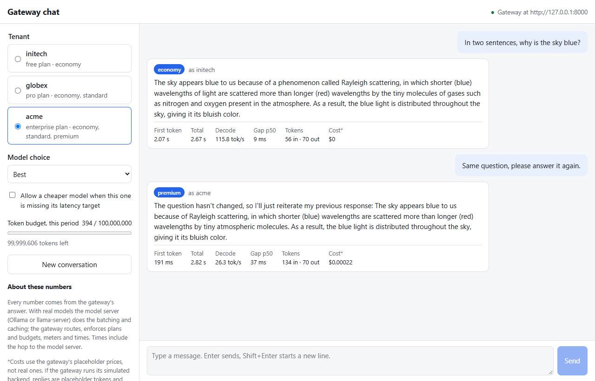

# chatbot-with-voice-agent

A multi-tenant chatbot whose every message goes through the
[Multi-Model Inference Gateway](https://github.com/bala5071/Multi-Model-Inference-Gateway-Simulator).
Pick a tenant, and the gateway picks the model that tenant's plan allows: the free plan gets
Llama 3.2 1B, the pro plan up to Llama 3.2 3B, and the enterprise plan up to Llama 3.1 8B. Each
reply shows which model answered, how long it took, how many tokens it used, and what is left of
the tenant's budget, all as the gateway reported them.



*A real run: the gateway in front of Ollama on one Windows laptop, 2026-10-18. Each number
in the picture is one request, not a benchmark. Costs use the gateway's placeholder prices.*

## What this shows, and what it does not

With real models the gateway runs its `LlamaCppBackend` + `PassthroughWorker` pair (the
gateway's `docs/12-real-models.md`). In that mode **the model server (Ollama or llama-server)
does the batching and the KV caching**, not the gateway.

| Shown here with real models | Not exercised here |
|---|---|
| Routing by plan, by quality (cheapest, balanced, best) or by model name | The gateway's continuous batching |
| Plan enforcement (a refused model gives the gateway's 403) | Its prefix cache (KV-cache stand-in) |
| Token budgets and the per-tenant ledger | Chunked prefill |
| SLO-aware downgrade to a cheaper model, if allowed | Its p99 performance gate |
| Streaming, with time to first token, gaps between tokens and total time | |
| The gateway's monitoring dashboard, watching the same traffic | |

The timings include the HTTP hop from the gateway to the model server and any wait inside
it. They describe one request on your hardware, not the gateway's scheduler. Cost figures
are real token counts multiplied by the gateway's **placeholder** prices.

## How it fits together

```
browser ──► chat backend (:8100) ──► gateway (:8000) ──► Ollama (:11434)
 React        FastAPI: history,        routing, plans,       Llama 3.2 1B / 3B,
 page         SSE relay                budgets, metrics      Llama 3.1 8B
```

The browser talks to the chat backend, not to the gateway, because the gateway sends no
CORS headers and takes a single prompt string per request. So the backend keeps each
conversation and writes its recent history into the prompt. See [docs/DESIGN.md](docs/DESIGN.md).

## Quick start (Windows)

With the gateway cloned beside this repository and Ollama installed:

```powershell
.\scripts\demo.ps1            # real models: Ollama + gateway + chat, opens the browser
.\scripts\demo.ps1 -LiveSim   # also the gateway's simulated live mode on port 8001
.\scripts\demo.ps1 -Simulated # no models at all
.\scripts\demo.ps1 -Stop
```

[docs/DEMO.md](docs/DEMO.md) is a ten-minute script for presenting the gateway with it.
The steps below do the same by hand, on any OS.

## Run it

You need Python 3.11+, [uv](https://docs.astral.sh/uv/), Node 20, [Ollama](https://ollama.com),
and the gateway cloned beside this repository:

```
Projects/
  Multi-Model-Inference-Gateway-Simulator/
  chatbot-with-voice-agent/
```

1. Pull the three models (about 7.7 GB; their licenses are Meta's, see the gateway's
   `docs/12-real-models.md`) and make sure Ollama is running:

   ```sh
   ollama pull llama3.2:1b-instruct-q4_K_M && ollama pull llama3.2:3b && ollama pull llama3.1:8b
   ollama serve        # if it is not already running
   ```

2. Start the gateway with this repo's backend config (in the gateway repository):

   ```sh
   GATEWAY_BACKENDS=../chatbot-with-voice-agent/config/backends.ollama-chat.yaml \
     uv run uvicorn gateway.app:create_default_app --factory --port 8000
   ```

   In PowerShell: `$env:GATEWAY_BACKENDS="..\chatbot-with-voice-agent\config\backends.ollama-chat.yaml"`
   on its own line first.

3. Start the chat backend (in `backend/`):

   ```sh
   uv sync
   uv run uvicorn gateway_chat.app:create_default_app --factory --port 8100
   ```

4. Either build the page once and open <http://127.0.0.1:8100>:

   ```sh
   cd frontend && npm ci && npm run build
   ```

   or run the dev server and open <http://127.0.0.1:5173>: `cd frontend && npm ci && npm run dev`.

Open the gateway's dashboard at <http://127.0.0.1:8000/dashboard> beside the chat to watch the
same requests arrive. Queue, batch and KV-cache panels show as unavailable in this mode,
because the gateway cannot see inside the model server.

The first message to each model can take several seconds while Ollama loads it.

**Without any model:** leave out `GATEWAY_BACKENDS` in step 2 and the gateway uses its
simulated backend. Routing, plans and budgets work the same; replies are placeholder tokens
and the timings are simulated.

### Things to try

- Ask the same question as **initech** and then as **acme** with *Best*. Compare the
  answers and the timings.
- As **initech**, choose the model **premium**. The gateway refuses with
  `model_not_in_plan` and lists the plans that include it.
- Ask a follow-up ("what did I just ask?"). The backend sends the earlier turns with it.
- Ask for a long essay and press **Stop**. The gateway cancels the request and frees the
  model.

### Settings

The chat backend reads these environment variables:

| Variable | Default | Meaning |
|---|---|---|
| `GATEWAY_URL` | `http://127.0.0.1:8000` | Where the gateway listens |
| `CHAT_TENANTS` | `initech,globex,acme` | Tenants offered in the picker (the gateway's demo tenants) |
| `CHAT_MAX_TOKENS` | `256` | `max_tokens` sent with every turn |
| `CHAT_HISTORY_CHARS` | `6000` | How much earlier conversation goes into each prompt |
| `CHAT_SYSTEM_PROMPT` | a short helpful-assistant prompt | Put at the top of every prompt |
| `CHAT_MAX_CONVERSATIONS` | `200` | Conversations kept in memory (least recently used dropped) |
| `CHAT_FRONTEND_DIR` | `frontend/dist` | The built page served at `/` |

Conversations live in memory only; restarting the backend forgets them.

## Development

```sh
# backend/
uv run ruff check . && uv run ruff format --check . && uv run mypy && uv run pytest

# frontend/
npm run check     # eslint, prettier, tsc, vitest
npm run e2e       # build, then Playwright against the backend and a fake gateway
                  # (PLAYWRIGHT_CHANNEL=chrome uses an installed Chrome)
```

The backend and browser tests run against `backend/tests/fake_gateway.py`, a stand-in for
the gateway's API with the same shapes, status codes and demo tenants. No model runs and its
numbers are made up. `backend/tests/test_contract.py` checks the client against a real
gateway, so that the fake cannot drift unnoticed. CI runs it against the gateway's simulated
backend:

```sh
# with a gateway running on :8000
CHAT_TEST_GATEWAY_URL=http://127.0.0.1:8000 uv run pytest -m gateway
```

CI never runs a model.

## Roadmap

- A voice mode: speech to text and text to speech around the same `/api/chat` turn.

## License

MIT for this code. The Llama model weights are under Meta's Llama 3.1 and 3.2 Community
License Agreements, not an open-source license. Read them before you rely on the models.
